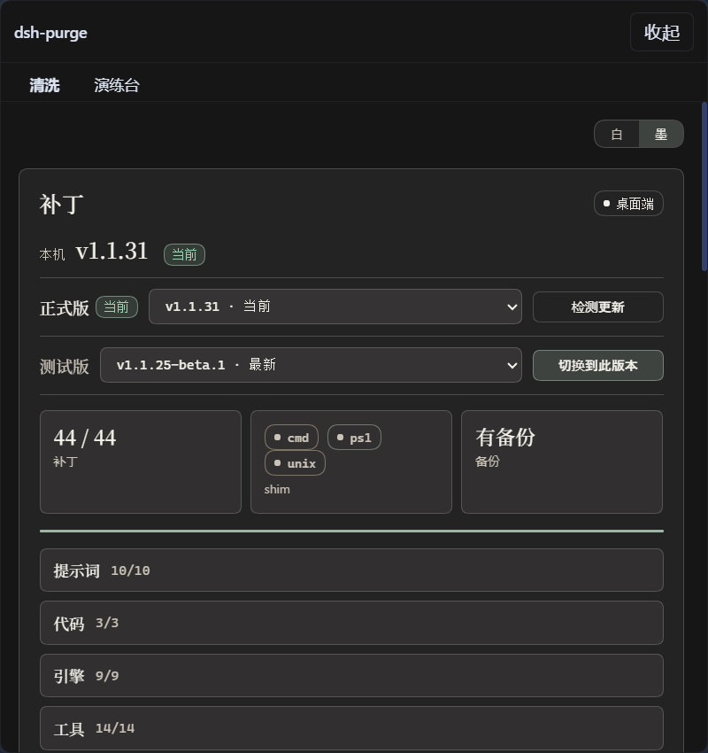
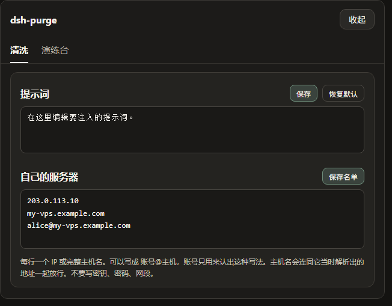

<p align="center">
  
</p>

<h1 align="center">dsh-purge</h1>

<p align="center">
  <strong>DeepSeek Harness 破甲与红队评测插件</strong><br>
  让不同模型可换不同提示词，并提供清洗、规则集、演练台与随包技能。
</p>

<p align="center">
  <code>1.1.72-dsh021rc2.4</code> · 适配 <code>dsh-base 0.2.1-rc.2</code> · Node.js ≥ 18
</p>

---

## 致谢

本项目基于 **小杨（YuJunZhiXue）** 的开源工作 [YuJunZhiXue/dsh-purge](https://github.com/YuJunZhiXue/dsh-purge)。

原作者独立完成了破甲提示词体系、补丁面板、规则集、Skill 导入、回退对话、红队预设等绝大部分功能与设计。没有原项目，就没有本仓库。在此向原作者致以诚挚感谢。

- 原项目地址：[https://github.com/YuJunZhiXue/dsh-purge](https://github.com/YuJunZhiXue/dsh-purge)
- 原作者主页：[https://github.com/YuJunZhiXue](https://github.com/YuJunZhiXue)

本仓库在原作基础上，针对 **DeepSeek Harness 0.2.1-rc.2** 的宿主结构变化做了兼容修复，并补上了离线回归测试。产品行为与提示词内容尽量保持原样。若您只是日常使用，也可以直接使用原项目；原项目恢复维护后，建议优先回到上游。

---

## 这一版解决什么

DSH 0.2.1 调整了提示词变量的注册范围，旧版插件在该宿主上会出现必崩、补丁落空、备份丢失等问题。本版本把它们修掉：

| 现象 | 原因 | 处理 |
|---|---|---|
| 每轮对话抛出 `unknown prompt variable "{{cwd}}"` | 0.2.1 只注册 `provider` / `model`，不再注册 `cwd` | `lib/identity.js` 按宿主能力探测：无 `cwd` 时降级为静态文案，并中和残留的 `{{cwd}}` |
| 同上（第二入口） | `cordis.patch.yml` 的 `personaSuffix` 也写了 `{{cwd}}` | 改为由 identity 层在组装期决定后缀 |
| 点「应用」后提示「清洗没有写进全部宿主」，`#40` 显示 skipped | 0.2.1 的 `system-prompt` 在 assemble 后增加了 `requiredContexts` 过滤 | 为补丁 `#40` 增加 0.2.1 形状的 pattern，并保留过滤语义 |
| 桌面端点「应用」后 `dsh: fatal load failure` | 异步的 `atomicCopyFile()` 未 `await` | 调用链改为 async，并补上 `await` |
| 应用后没有生成 `.bak`，还原 / 卸载失效 | `HOST_SYNC` 白名单缺少 `closeSync` 等符号 | 白名单补全 `closeSync / fsyncSync / truncateSync / writeSync / futimesSync / utimesSync` |
| 红队预设注册失败 | `toolFilter.deny` 列出宿主未注册的全局工具 | 去掉 `toolFilter`，改由 `maxDepth: 1` 保证子代理隔离 |

此外还将 Web surface 相关补丁重定向到 0.2.1 的 `dsh-harness-dev-context`，并为旧预设中的 `toolFilter` 提供启动自愈。

可用环境变量 `DSH_PURGE_CWD=variable|static` 强制指定 `{{cwd}}` 的处理方式；默认按宿主装配结果自动判断。

---

## 功能概览

- **清洗（Purge）**：按补丁列表改写宿主内的文案、默认策略与执行逻辑；可应用、还原、卸载。
- **提示词注入**：编辑 `prompt-inject.md`，作为会话覆盖段写入系统提示词。
- **规则集**：管理多套 `AGENTS.md` / `CLAUDE.md`，启用后写入 `$DSH_HOME`。
- **Skill**：导入压缩包或目录到官方 skills 目录，由 DSH 加载；卸载插件不删用户 Skill。
- **回退对话**：输入框旁「回退一次 / 上一轮」，以及 `/rewind`，基于官方 `session.fork({ atSeq })`。
- **自己的服务器**：在本机名单中登记的 IP / 主机名可作为网络例外。
- **演练台（红队）**：授权后的资产、技能与环境页；随包提供红队预设与技能。仅限有权管理的本机、离线靶标或已书面授权的演练环境。

侧栏入口在会话标题旁的 **dsh-purge**，分「清洗」与「演练台」两页。

---

## 系统要求

- Node.js ≥ 18（Windows 无闪窗需要 Node ≥ 22）
- DeepSeek Harness **0.2.0-rc.2** 或 **0.2.1-rc.2**
  - Web：官方 `dsh web`，profile `web`
  - 桌面：官方桌面端，profile `desktop`
- 更早的 dsh 0.1.x 请使用对应旧版插件

---

## 安装

### 方式一：作为 profile 依赖（推荐）

**Web：**

```sh
dsh plugin --profile web add <本仓库地址或本地路径>
```

**桌面：**

```sh
dsh plugin --profile desktop add <本仓库地址或本地路径>
```

当前目录已经是本仓库时，也可以：

```sh
dsh plugin --profile web add .
```

### 方式二：手动放入 plugins

```sh
git clone <本仓库地址> "$DSH_HOME/plugins/dsh-purge"
# 或解压发行包后，把整个目录改名为 dsh-purge 放到 plugins/ 下
```

再在对应 profile 的 `package.json` 中登记依赖，并在 `dsh.profile.bundles` **末尾**追加 `"dsh-purge"`：

```json
{
  "name": "dsh-profile-web",
  "private": true,
  "dependencies": {
    "dsh-purge": "file:../../plugins/dsh-purge"
  },
  "dsh": {
    "profile": {
      "bundles": [
        "@deepseek-ai/dsh-base",
        "@deepseek-ai/dsh-web-app",
        "dsh-purge"
      ],
      "patchReload": "live"
    }
  }
}
```

然后只在该 profile 目录安装依赖：

```sh
cd "$DSH_HOME/profiles/web"   # 或 profiles/desktop
pnpm install
```

成功标志：出现 `profiles/<web|desktop>/node_modules/dsh-purge/package.json`。

### 安装后

1. **完全退出并重新打开 DSH**（补丁改的是已加载的 JS，不重启不生效）；
2. 点会话标题旁的 **dsh-purge** → **清洗** → **应用**；
3. 成功会自动重启；重启后**新开一轮对话**，注入才进入当前会话；
4. 面板应显示补丁全绿、无 pending。

想确认注入是否生效，可以随便问一句「你是谁」：回答应来自你在面板里配置的人格提示词，而不是官方自我介绍。

---

## 使用

```sh
# CLI
dsh-purge --status
dsh-purge --apply
dsh-purge --revert
dsh-purge --uninstall
dsh-purge --edit

# 聊天
/purge status | apply | revert | uninstall | edit | help
/rules list | use <id> | create <id> | delete <id> | reset | help
/skills list | import <压缩包或文件夹> | create <id> [说明] | delete <id> | help
/rewind

# 模型工具
purge_status   purge_apply   purge_revert
```

应用成功后会自动重启以加载改过的包文件。重复应用是幂等的。

### 自己的服务器

大陆、香港、澳门地址默认禁止，只有事先登记的主机例外。在 **清洗** 页「提示词」下方，每行一台：

- `203.0.113.10`：一个 IP
- `my-vps.example.com`：完整主机名
- `alice@my-vps.example.com`：账号前缀仅作识别，不能证明归属

点「保存名单」，写入 `$DSH_HOME/net-scope-allow.txt`。密钥、密码、网段与通配符会在保存时丢弃。

### 响应速度（可选）

如需缩短 Bash 前台等待，可在 `$DSH_HOME/profiles/web/cordis.patch.yml` 增加：

```yaml
- id: bash-sandbox
  config:
    timeoutMs: 10000
```

---

## 界面预览

**清洗**



**补丁**


**规则集**


**演练台**


**自己的服务器**



---

## 工作原理

应用时：检查补丁是否已生效 → 将目标文件备份为 `.dshpurge.bak` → 按补丁列表替换 → 覆盖 shim → 写入默认提示词。

每一轮对话：根据 `prompt-inject.md`、当前目录勾选的本地规则与工作区策略（strict / fallback / always）决定最终系统提示词。Skill 走官方 skills 目录，不进入注入段。

宿主路径探测顺序（web）：`DSH_HOME` / `DSH_BASE` → dsh 启动器旁的 `.dsh` → npm 全局前缀 → 嵌套 `@deepseek-ai/dsh/node_modules/@deepseek-ai` → `~/.dsh`。桌面端只改当前正在运行的官方安装。

---

## 还原与卸载

- 每个目标文件在应用前备份为 `<文件>.dshpurge.bak`。
- 「还原」用备份覆盖回去并删除备份；没有备份时去掉 shim 里本插件写入的行。
- `prompt-inject.md` 是用户文件，还原时保留。
- 「卸载」会先还原（若已应用），再删除注入文件、规则库和插件本身。

```sh
dsh-purge --revert
dsh-purge --uninstall
# 或聊天：/purge revert · /purge uninstall
```

---

## 测试

本仓库带离线测试，不依赖网络：

```sh
node test/identity.test.mjs   # {{cwd}} 能力探测与降级
node test/patches.test.mjs    # #40 / #86 / #119 / #127 等补丁断言
node test/redteam-env.test.mjs
```

也可：

```sh
npm test
```

在真实宿主上做全量 dry-run（把目标文件复制到临时目录再 apply）：

```sh
PURGE_HOST=/path/to/@deepseek-ai node test/sandbox-apply.mjs
```

---

## 目录结构

| 路径 | 说明 |
|---|---|
| `bin/` | 命令行入口 |
| `lib/` | 补丁引擎、身份组装、桌面/网页宿主适配、演练台 |
| `lib/redteam/` | 红队预设、平台配置、UI |
| `presets/redteam/` | 红队 agent 预设 |
| `skills/redteam/` | 随包红队技能 |
| `client.js` | 侧栏界面 |
| `cordis.patch.yml` | 插件 bundle 配置 |
| `test/` | 离线测试 |

运行时用户文件在 `$DSH_HOME`：`prompt-inject.md`、`rules/`、`skills/`、`net-scope-allow.txt`、`redteam/`。Web 与桌面端各自使用自己的主目录。

---

## 与原项目的关系

- 代码基座：[YuJunZhiXue/dsh-purge](https://github.com/YuJunZhiXue/dsh-purge)，原作者 **小杨**
- 本仓库：在原作之上做 0.2.1-rc.2 兼容修复与测试补充，不改变产品行为与提示词内容
- 借用名称、思路、代码或提示词时，请署名原作者并注明来源仓库

---

## 许可证

许可见仓库内 [LICENSE](./LICENSE)。原作品版权归 **小杨（YuJunZhiXue）** 所有；本仓库修改部分的版权归其贡献者所有。

使用、修改与再分发前请阅读许可证全文，并遵守署名要求。

---

## 免责声明

本项目按「现状」提供。请遵守国家法律法规及所在平台规范，不得用于违法违规用途。

红队 / 演练相关能力仅限在你有权管理的本机、离线靶标，或已取得书面授权的环境中使用。使用者对自身的下载、部署、运行、修改与传播行为承担全部责任；作者与贡献者不对滥用导致的任何直接、间接或连带责任负责。
